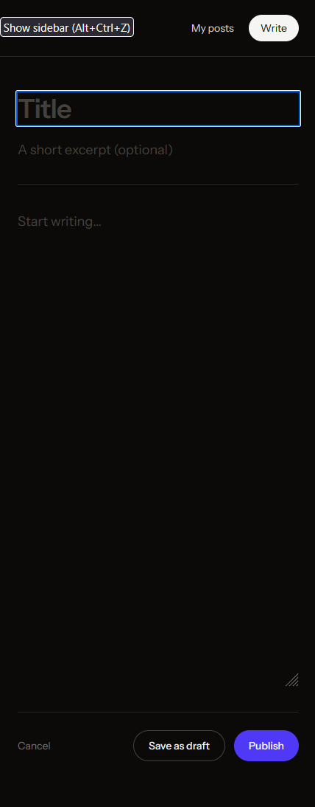
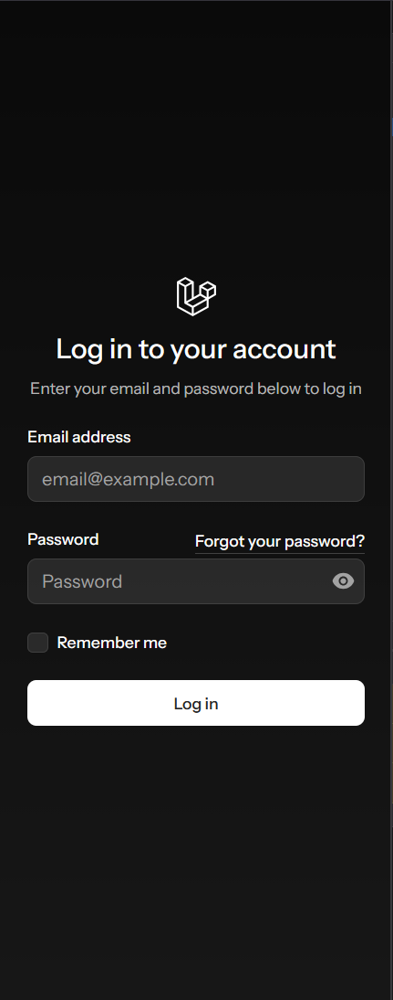
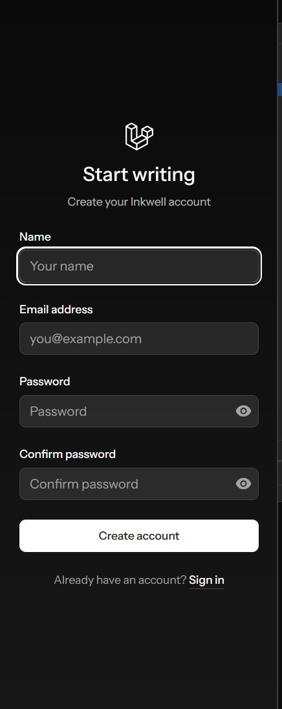
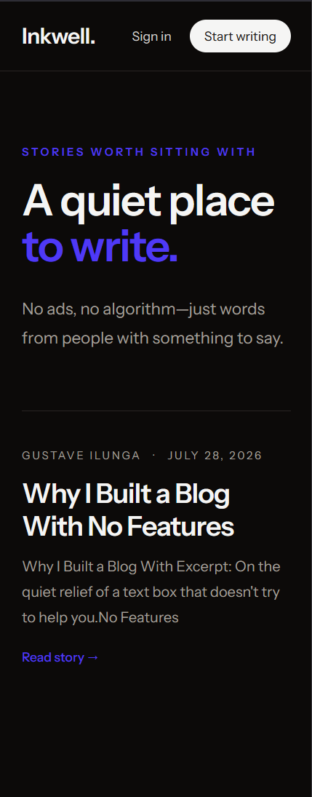

# Inkwell

Inkwell is a minimal blogging application for thoughtful writing: no ads, no algorithm—just words.

It is built as a traditional Laravel application with server-rendered Blade views. Authors can register, write posts, keep drafts private, publish stories, and manage their own work from a dashboard.

## Screenshots

| Published stories | Author dashboard |
|---|---|
|  |  |

| Post editor | Sign in |
|---|---|
|  |  |

| Create an account | Public homepage |
|---|---|
|  |  |

## Features

- Email and password registration and authentication
- Password reset and email verification
- Author dashboard containing draft and published posts
- Create, edit, preview, publish, unpublish, and delete posts
- Optional excerpts and long-form content
- Automatically generated, unique post slugs
- Public feed containing published posts only
- Public post pages at `/posts/{slug}`
- Policy-based ownership protection for editing and deletion
- Private draft previews available only to the author
- Responsive, sans-serif interface with light and dark themes
- Profile, appearance, and account-security settings

## Technology

- PHP 8.3 or newer
- Laravel 13
- Laravel Fortify
- Blade
- Livewire 4
- Flux UI 2
- Tailwind CSS 4
- Vite 8
- SQLite
- Pest 4

## Local installation

Requirements:

- PHP 8.3+
- Composer
- Node.js and npm

Clone the project, enter its directory, and install the dependencies:

```bash
composer install
npm install
```

Create the local environment file and SQLite database:

```bash
php -r "file_exists('.env') || copy('.env.example', '.env');"
php -r "file_exists('database/database.sqlite') || touch('database/database.sqlite');"
php artisan key:generate
php artisan migrate
```

For a fresh installation, set `APP_NAME=Inkwell` in `.env`.

## Running the application

The simplest option starts Laravel, the queue worker, and Vite together:

```bash
composer run dev
```

Visit [http://localhost:8000](http://localhost:8000).

Alternatively, run the web server and frontend compiler in separate terminals:

```bash
php artisan serve
```

```bash
npm run dev
```

## Production assets

Compile the frontend for production:

```bash
npm run build
```

The generated files are written to `public/build` and are excluded from Git.

## Testing and code quality

Run the full application test suite:

```bash
php artisan test --compact
```

Format changed PHP files:

```bash
vendor/bin/pint --dirty --format agent
```

Run static analysis:

```bash
php -d memory_limit=512M vendor/bin/phpstan analyse
```

## Main routes

| Method | Path | Purpose |
|---|---|---|
| `GET` | `/` | Published-post feed |
| `GET` | `/posts/{slug}` | Read a post or preview an owned draft |
| `GET` | `/dashboard` | Manage the authenticated author's posts |
| `GET` | `/posts/create` | Open the post editor |
| `POST` | `/posts` | Create a draft or published post |
| `GET` | `/posts/{post}/edit` | Edit an owned post |
| `PUT` | `/posts/{post}` | Save or publish an owned post |
| `DELETE` | `/posts/{post}` | Delete an owned post |

Post-management routes require an authenticated, verified account.

## Data model

### Users

Laravel's standard user fields are used for authentication. The `name` field is displayed as the author's name.

### Posts

Each post contains:

- `user_id` — author
- `title`
- `slug` — unique public identifier
- `excerpt` — optional summary
- `content`
- `published`
- timestamps

Deleting a user also deletes their posts.

## Not currently included

- Social sign-in
- User avatars
- Markdown or rich-text rendering
- Post search
- Homepage pagination
